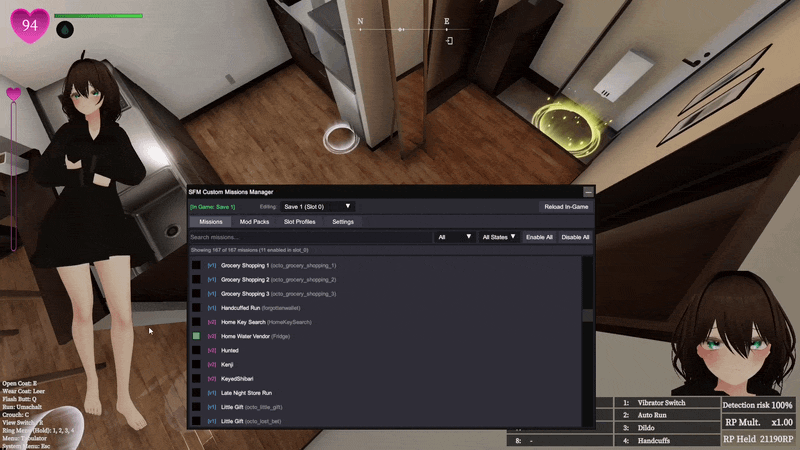

# Custom Missions Manager

Allows you to easily manage custom missions v1 and v2 with hot reloading and a GUI.

The default hotkey to open the UI is `F10`, this can be changed in the settings.

> [!WARNING]
> `SFM_custom_mission_v2` comes with its own v1 engine, called `CM1 Emulator`, **do not use it**. You must use the separate `SFM_custom_mission` mod.

